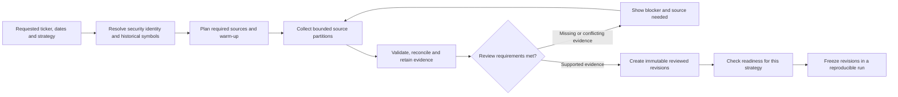

# Requested-company onboarding

The **Company onboarding** page (`/companies`) accepts a US-listed ticker,
research dates, benchmark, warm-up and requested capabilities. Durable worker
jobs collect evidence and generate an immutable report. Explicit review creates
an immutable package referencing existing dataset/source contracts. There is
no AAPL/MSFT allowlist. Real NVDA collection and review have been demonstrated
in isolation; full-period AAPL/MSFT/SPY onboarding and the research cycle now pass
in a [separate Docker project on 18082](full-cycle-verification-2026-11-06.md).
The existing Docker application on port 18080 remains unchanged. See [measured verification](company-onboarding-verification-2026-11-06.md).

## Readiness belongs to a capability and date range

“All data” must mean the declared sources and fields required for the requested
strategy. No collector can certify that it captured every company article or
every piece of information a human could have encountered.

| Capability | Evidence needed before use |
| --- | --- |
| Daily accounting | Raw daily bars, covered sessions, original split/dividend evidence, payment dates, historical FX policy |
| Intraday decisions/execution | Complete supported intervals, actual exchange sessions and declared completion/delivery policy |
| Company filing events | CIK/security mapping, specified form families, primary documents, amendments and publication policy |
| Macro inputs | Shared release/vintage streams, units, original values and availability; not recollected for every company |
| Sector selection | Historical classification and membership changes, not current sector metadata alone |
| News/ratings/disclosures | Declared archival coverage, original versions and timestamps, permitted source access |

Missing analyst history need not prevent a price-only strategy from using a
qualified accounting dataset. It must prevent a strategy that requires that
analyst history. The existing readiness endpoint already checks many of these
dependencies and rejects missing classifications or unreviewed inputs.

## Implemented collection and review

1. Resolve the current SEC ticker/exchange mapping to CIK. An explicit reviewer
   attestation must establish historical ticker/share-class continuity. Renames,
   delisted stocks and terminal actions are not automatically resolved.
2. Reuse reviewed immutable accounting, FX and SEC streams when their date,
   symbol, completeness and policy scopes cover the request. Otherwise fetch
   raw Alpaca SIP bars and corporate-action candidates. SGD requests require an
   existing reviewed FX revision; the coordinator does not automatically approve
   or refresh FRED/ALFRED data. Shared BLS/macro inputs remain separately selected.
3. Retain original response bytes, URLs, hashes and source metadata. SEC collection
   inventories current and historical submission partitions and retains complete
   8-K/8-K/A submission texts. It checks acceptance timestamps, accession, CIK,
   primary filename/form and literal item headings. Amendments remain additive.
4. Report gaps, provider failures, limits and unsupported capabilities explicitly.
   Extract dividend/split text into **review proposals**, never eligible data.
   Review must reconcile every broker candidate and attest complete supported
   split/dividend coverage, including missing broker actions and no-event intervals.
5. Require evidence quotes from retained issuer records supporting nominal amounts,
   dividend payment dates, split ratios/effective dates and availability. Broker
   ex-dates require reviewer reconciliation; amount/payment-date corrections need
   issuer support. Conflicting candidate ex-dates, duplicate action keys or symbols
   cannot be overridden in this report and require the existing manual reviewed
   import path. Text matching
   does not establish their economic meaning or complete source coverage. A supplied
   issuer transcript is retained and labeled as reviewer supplied; its URL is never
   fetched by the server. Availability cannot precede the evidence clock or exceed
   the action's effective session open.
6. Explicit policy/identity/coverage review creates accounting revisions and reviewed
   SEC children **atomically** with the package. Raw parents and collection-time
   reports remain unchanged. Approvals can cover one supported capability while
   others remain blocked. Identical review requests reuse the package identity.
7. Select the resulting dataset and source IDs in the existing New backtest form.
   Run-specific readiness still checks the strategy, profile, indicator warm-up
   and selected input coverage. Strategy draft review/publication remains separate.

### Scope, clocks and bounds

- Initial orchestrated capabilities: daily accounting and SEC filing presence/item
  tags. Intraday, historical sectors, general company news, analyst ratings and
  Congress requests display blockers; their existing manual/provider import paths
  are unchanged. An SEC filing is not sentiment or comprehensive company news.
- Bars are current revised, raw SIP history with assumed 20:15 New York availability
  and 20:30 decisions. SEC publication/availability use a conservative next-session
  **close** proxy after acceptance, not an observed first-public timestamp.
- UI defaults: SGD, reference-FX maximum age 14 days, SPY benchmark, 730 calendar
  warm-up days. API additionally supports USD and FX ages 1–14 days. Full 2018–2025
  requests are supported within the collection bounds; raise the document limit
  explicitly when necessary. No missing prices, FX or dates are substituted.
- Requests allow at most 5,000 calendar days including warm-up, 1,096 warm-up days,
  200 SEC documents (default 100), 20 SEC archive partitions, 240 HTTP requests and
  10 corporate-action pages. Exceeding a limit blocks collection, without truncation.
  Environment defaults: 256 MB total retained bytes, 32 MB per artifact, 1,200 s
  processing deadline. SEC requests are spaced by at least 1.1 seconds per collector.
  Use one collector worker; there is no cross-worker SEC rate limiter.
- Idempotency keys protect request retries. Cancelled/failed attempts and their raw
  evidence remain retained; explicit retry creates a new attempt with fresh price,
  action and filing collection. Reviewed FX is reused. Source timeouts bound cancel
  latency; no automatic retry loop or provider-subscription scheduler is supplied.
- The shared worker processes one backtest then one intake per cycle. A long job
  delays the other queue. `--once` processes up to one from each queue. Worker leases
  reject stale publishers; queued work persists across process restarts.

### Configuration and endpoints

Configure server-side `ALPACA_API_KEY`, `ALPACA_SECRET_KEY` and
`DATA_SOURCE_CONTACT_EMAIL` in the API **and worker** environment. The SEC contact
is used in its identified User-Agent. These existing values were sufficient for
the live NVDA test; no new vendor key was needed. An API key is not proof of data
entitlement. Local processes load `.env` from their working directory; Docker
already passes the root `.env` to API/worker. No credentials are returned to the UI.

Optional limits: `INTAKE_MAX_BYTES`, `INTAKE_MAX_ARTIFACT_BYTES`,
`INTAKE_MAX_SECONDS`, and existing `MAX_ACTIVE_JOBS` (per collection queue).
Migration **005_company_intakes** adds collection requests, append-only raw
artifacts/links, reports and packages, with SQLite/PostgreSQL immutability triggers.
Run `python -m alembic upgrade head` against the intended project database before
starting the updated API and worker. Rebuild the frontend to expose `/companies`.
Do not point migrations at an unrelated homelab database.

API prefix: `/api/company-intakes`. `POST /` queues; `GET /` lists attempts;
`GET /{id}` returns report/artifact metadata/packages; `POST /{id}/cancel` and
`POST /{id}/retry` control attempts; `POST /{id}/evidence` retains a transcript;
`GET /{id}/artifacts/{artifact_id}` downloads checked raw bytes;
`POST /{id}/approve` requires the exact report hash and explicit attestations.
`GET /configuration` reports supported capabilities, credential-presence booleans
and limits. The API OpenAPI schema defines bounded request/review shapes.

## What this pilot demonstrates and leaves open

The [AAPL/MSFT accounting and import verification](company-intake-verification-2026-11-06.md)
adds those symbols through existing inputs without application code changes. It
also exposes cases the coordinator must handle: broken issuer archive links,
date-only announcement clocks, differing declaration dates, spreadsheet numeric
artifacts and New York/UTC coverage boundaries.

The implementation now supplies the request UI, persistent collection jobs,
current identity resolution and immutable review reports. General issuer-site
adapters, historical identity/universe reconstruction and terminal-action support
remain pending. The real NVDA smoke adds a third ticker, including a split and
post-split dividend. It qualifies that bounded interval under recorded research
policies; it does not certify every US-listed equity or an exact historical
information delivery archive.
