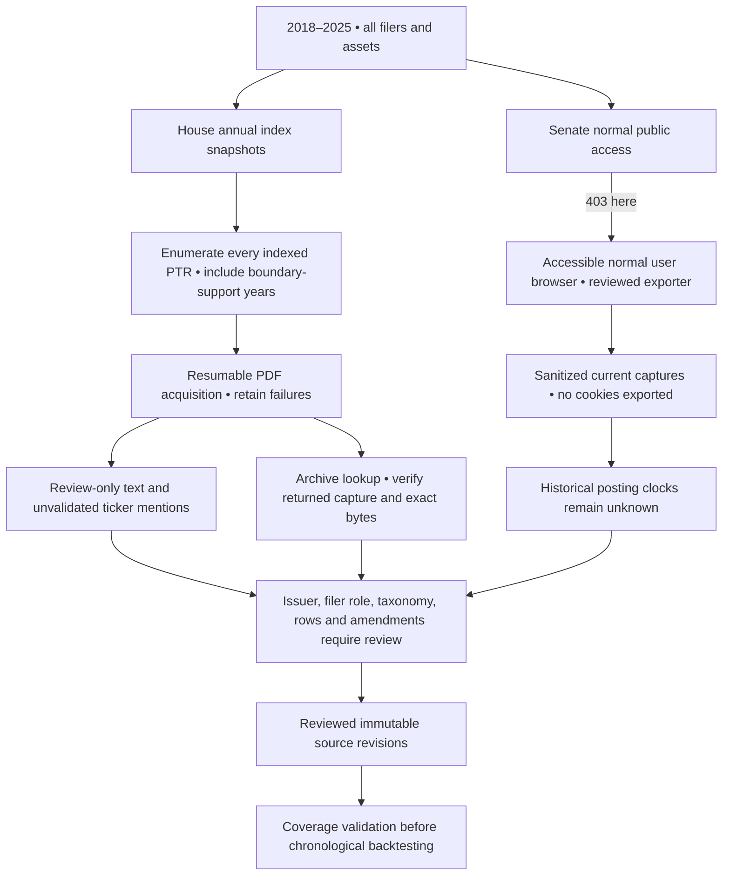

# Full Congress PTR acquisition and Senate access

The [retail-feed follow-up](retail-information-pilot-2026-11-08.md) accepts a
qualified retail provider as an alternative delivery path. Senate access is not
a prerequisite for news/earnings/insider work; the earlier raw House acquisition
is separate evidence and does not automatically become eligible.

**Full historical Congress coverage is not qualified yet.** The new coverage page
inventories all available House PTRs across a requested period and acquires their
source evidence in a durable queue. Senate access from this environment remains
blocked; a normal-browser export/import path is provided. Acquired documents and
unreviewed extraction are never treated as a strategy-ready dataset.

## Scope and current progress

The active request is 2018–2025 for both chambers, with 2017 and 2026 supporting
House indexes for boundary originals, late filings and amendments. All ten House
index responses are retained and independently counted:

| Index year | Available PTR records | Role |
| --- | ---: | --- |
| 2017 | 801 | Supporting index |
| 2018 | 830 | Primary period |
| 2019 | 683 | Primary period |
| 2020 | 733 | Primary period |
| 2021 | 680 | Primary period |
| 2022 | 624 | Primary period |
| 2023 | 460 | Primary period |
| 2024 | 451 | Primary period |
| 2025 | 515 | Primary period |
| 2026 | 457 | Supporting index |

That is **4,976 primary-period records plus 1,258 supporting records = 6,234**.
This is the complete available PTR listing in those retained current indexes,
not proof that every historical report remains available, every filer was then a
Member, or every real-world transaction was reportable/disclosed. Annual/termination
financial statements are not normalized as PTR trade records by this queue.
Historical membership/filer role and asset/security identity require review.

The 18092/15450 collection has now acquired **all 6,234 indexed PDFs**.
The archive-bound phase is **blocked_access**, as confirmed by the later retail
pilot audit. These are raw documents, not a qualified full-Congress dataset. Open
`/congress/coverage` and select request `3bf23ee8-256e-4d3d-ba3b-213a03ad54d6` for
live counts. The [HTML workflow](data-workflow.html#congress-coverage) includes
a diagram of the acquisition and remaining review gates. At the durability
checkpoint, **1,213 PDFs** had been acquired; those
records survived recreation/database restart and the same request resumed.
The final audit at **2026-11-08 00:18 UTC** recorded **2,606 acquired PDFs**;
This was an earlier in-progress checkpoint; the later audit confirms all 6,234
PDFs acquired before the archive access block.
These figures are acquisition evidence, not qualified observations or completed
full-period backtests. The archive phase follows document acquisition.

## Durable acquisition controls

Migration 009 adds collection jobs and report tasks. Request payloads/hashes are
immutable; document status, cancellation, lease/heartbeat and progress are mutable.
Batches contain 12 reports with pauses between requests. Successes and failures
retain immutable source artifacts. Cancel stops at a checkpoint; resume retries
missing evidence without discarding successful records or changing the scope.
A stale lease resumes unfinished work. 403/429 stops the affected source rather
than triggering an access-control workaround.

Bulk PDFs are bounded to 32MB per response. A 4GB raw-document acquisition budget
is checked between batches; larger histories must use explicit partitions.
Extraction is bounded to 100 pages/1M text characters per PDF and may fail or yield
only partial text. Successful raw acquisition survives extraction failure. Image
scans, unsupported layouts and ticker-like strings require review; no empty trade
history is fabricated. `pypdf 7.0.0` is pinned and records its extraction policy.

Archive lookup uses the filing date only as a **search target**, never as a public
clock. The returned capture timestamp, HTTP 200, matching Memento header and exact
PDF bytes are required for an observed-public bound. A closest capture need not
be the earliest capture and can be much later. Unknown/failed/mismatched captures
stay gaps, with no date or observation substituted. Original-vintage corrections
require review rather than backdating current text.

## Cross-year originals and amendments

The bounded canonical-ledger workflow now accepts up to four additional retained
annual indexes in `supporting_index_artifact_ids`. Originals and amendments must
match the same reporter and their own retained index/PDF identities. Conflicting
identities, unknown predecessors or missing clocks remain blocked. This supports
cross-year lineage without pretending a single annual index covers earlier
originals. Legacy ledger requests omit the new empty optional field on serialization,
so existing immutable ledger hashes and reapproval remain compatible.

Full-history acquisition does not auto-approve any rows or combine partially
reviewed cohorts into an all-Congress feed. The earlier qualified March 2022 Pelosi
cohort remains unchanged. Its short real backtest still reproduces exactly under
engine 2.0.0; raw bulk documents do not affect that result.

## Senate access: specific user action

Both a normal server request and an ordinary Playwright browser receive **HTTP 403**
from `https://efdsearch.senate.gov/search/home/` before the acknowledgement can be
submitted. No challenge bypass, proxy rotation or cookie export was attempted.
The official public page is readable through the search tool, which does not give
this application's browser a working search session. The
[Senate portal](https://efdsearch.senate.gov/search/home/) describes report
availability and retention; this prevents treating a missing current report as
proof that no historical transaction existed.

If the portal opens from your own normal browser:

1. Complete its displayed acknowledgement and select the intended PTR/date/filer
   query. Include the appropriate former-Senator scope; do not assume the current
   roster is a historical universe.
2. Download `/senate-browser-export.js` from the new app, read it, and run it as a
   DevTools Snippet on the official **public search** page. It does not work on
   the separate authenticated filing portal. Do not bypass any browser/site
   security prompt; normal downloads are also acceptable for separate review.
3. Describe the actual query scope when prompted. The exporter follows normal
   current-table paging and same-origin report links, stopping on denial/rate
   limiting. It saves JSON parts locally; cookies, headers, scripts and hidden
   token fields are not included. It does not send data to a third party.
4. Import each part on **Full Congress coverage → Senate normal-browser access
   and import**. The server rejects inappropriate report URLs and unsafe hidden/
   script fields. Imports are retained as unreviewed evidence with no historical
   `public_at` time. The supplied query/pagination claims remain review assertions.

**No new API key is required for this public access workflow.** What is missing
is a normally accessible Senate session or permitted report exports, followed by
qualified historical posting/archival evidence, identities and amendment review.
Today's browser captures do not prove what was observable in 2018–2025. The exporter
passes synthetic sanitization/format checks but is **not verified against a live
accessible Senate search/results session** here. No real Senate report has been
imported during this phase.

## Verification and limits

**283 backend tests including PostgreSQL and 60 frontend tests pass**, plus
lint/format/build and migration/drift checks. New cases cover all-filer discovery,
seven/eight-digit IDs, cancellation/resume/denial, stale leases, immutable request
hashes, raw preservation after text failure, cross-year lineage and fail-closed
Senate imports. The documentation diagram passes four desktop/mobile browser checks.
The exporter passes 5 browser checks using explicitly synthetic,
locally fulfilled pages; this is not a Senate access success.

Eight actual browser checks pass for the live coverage page, full index counts,
background progress, explicit Senate denial, arbitrary filer filtering, local
export-script delivery and 390px layout. Existing engine 2.0.0 is unchanged. A new
replay of the earlier independently reconciled bounded Congress case matches its
full result hash and SGD 9,992.07338455 ending value exactly; no full-Congress
performance is claimed.

The new API/frontend/worker/PostgreSQL stack is isolated. The earlier proxy defect
was reproduced: Nginx retained an API container's old address after replacement.
Docker DNS re-resolution fixes it; recovery passed after the API address changed.
A checkpointed 1,213-record acquisition survived recreation/database restart before
resuming. The read-only audit confirms all **52 pre-existing containers unchanged**, all
**35 older results** preserved, **10 prior results** copied identically, and
**25 conversation turns / 9 publication transcripts** retained. Earlier journal
and qualified cohort records are unchanged. Runtime data,
responses and tests are private under `.local/congress-coverage-20261108/`.

**Remaining blockers:** Senate's 403 here, completion of bulk acquisition and archive
checks, missing/removed reports, original public-observation evidence, scanned or
ambiguous rows, historical filer/issuer identities and exhaustive amendment review.
Until those are resolved and coverage is explicitly reviewed, the full 2018–2025
Congress backtest remains unavailable. No missing data is replaced with zero.
