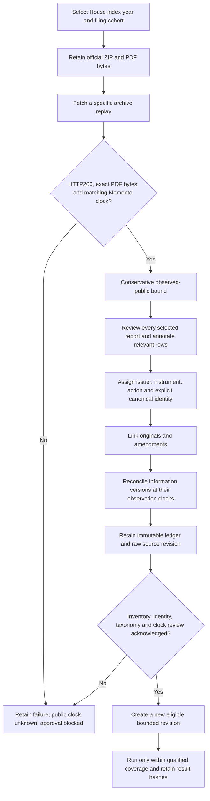

# Canonical Congress disclosure workflow

The **Congress source review** page supports bounded House index/PDF acquisition,
exact archive verification, manually annotated transaction ledgers and explicit
source approval. Engine2.0.0 is unchanged. The first real acceptance covers Nancy
Pelosi's March2022 PTR filing cohort for AAPL/MSFT, with a supporting February
original; it is not an all-Congress or complete2018–2025 feed.

## Three different meanings of “the same transaction”

A filing row is a disclosure observation, not necessarily another economic trade.
The ledger keeps an `observation_id` for each row and an explicitly reviewed
`canonical_transaction_id` for the underlying transaction. There is no fuzzy
merging by ticker, date or amount. Two charitable gifts with identical dates and
ranges can remain distinct transactions.

Amendments identify an earlier-filed retained predecessor. The ledger rejects
missing/cross-transaction links, different reporter/owner/issuer anchors,
branching chains, duplicate roots and unresolved cycles. Supporting originals
must match the reporter/date in the retained index. At each verified observation
clock, the newest **already observed filing version** wins:

| Case | Normalized behavior |
| --- | --- |
| A transaction first becomes observable | Emit one event at its verified public-observation bound |
| Later amendment changes only notification date or numeric formatting | Retain the amendment audit; do not emit another event or refresh the lookback |
| Later amendment changes a supported economic fact | Emit a causal replacement using existing event supersession; earlier clocks retain earlier facts |
| An older original is captured after its amendment | Retain the original as evidence; do not duplicate, revert or refresh the newer facts |

The supported economic fingerprint includes reporter/owner/security identity,
instrument/action, transaction date, disclosed amount range, share/contract
quantities and strike when supplied. Unmodeled narrative changes need explicit
review and, if necessary, a new preparation policy; this workflow does not infer
arbitrary economic meaning from PDF prose.

## Use the page

1. Acquire the official House annual index. Enter a seven- or eight-digit document ID and,
   when known, a UTC archive-capture timestamp. The server constructs fixed HTTPS
   URLs; it does not fetch arbitrary user URLs or follow redirects. Archive lookup
   discovery is manual in this phase. No new API key is required.
2. Download the retained official and archived PDFs and review all selected-domain
   reports. An unknown or failed replay stays unknown. Acquisition alone is not
   approval. HTTP failures remain visible and retained when a bounded response was
   received; no anti-bot bypass is used.
3. Prepare a ledger packet using the API schema available in `/docs`. It names the
   reporter, filing interval, company symbols, stream, observation-coverage
   interval, retained index and all reviewed reports. Each selected row references
   exact artifacts, filing/transaction/notification dates, issuer CIK and historical
   identity evidence URL, instrument/action, reported code, amount range,
   transcript and reconciliation note. Original/amendment relationships are
   explicit. Reviewer-supplied transcripts and identity links are not automatically
   authenticated or extracted from PDF text.
4. Inspect canonical rows and the information timeline. Unknown clocks, unknown
   instrument/action/amounts or an incomplete selected-report inventory block
   approval. Synthetic evidence cannot be relabeled real. The page displays
   download links, hashes, lineage, suppressed observations and blockers.
5. Acknowledge the conservative clock policy, complete **selected** report/row
   inventory, and identity/taxonomy/amendment review. Add a substantive review note.
   Approval retains the raw revision and creates a new eligible child, plus an
   immutable approval record. It approves only the named filing cohort/policy.
6. Select that source revision in the existing strategy-input and backtest flows.
   Use its exact stream/categories. Missing full-period coverage rejects a run;
   approval does not turn a small cohort into an eight-year feed.

The annual index is a current download, not an original index vintage. Its filing
dates select the review cohort; they never become event clocks. A transaction or
notification date is also not its public-posting date. The official
[2022 House PTR instructions](https://ethics.house.gov/wp-content/uploads/2024/11/Final-PTR-Form-CY-2022_0.pdf)
describe these distinct transaction/notification fields. Exact archived bytes and
`Memento-Datetime` provide a conservative observed-public bound, not proof of first
release. A replay differing from the current official PDF is blocked pending a
separate vintage review rather than being silently replaced.

## Explicit taxonomy and legacy compatibility

New canonical Congress details retain the reported code separately from the
classified action. Supported actions include `option_exercise` and
`charitable_transfer`; a reported `P` code on an exercise is not automatically an
ordinary equity purchase. Categories distinguish `congress_equity_purchase`,
`congress_call_option_purchase`, `congress_option_exercise`, transfers and other
supported combinations. Option observations do not enable option execution.

Existing legacy Congress payloads remain readable and serialize without the new
null metadata fields. Their raw hashes and earlier results are preserved. New
canonical details carry instrument, canonical transaction and observation IDs,
and the reported code. Neither a disclosed dollar range nor a share quantity is
an exact execution price or a recommended trade size.

The implementation reuses immutable `source_artifacts` and strategy-input
revisions; no database schema change or new simulator is introduced. The existing
PostgreSQL/SQLite migration protections apply to the artifact rows. Responses are
limited to4MB, total unique ledger evidence to64MB, a filing domain to one calendar
year, reports to100 and observations to500. Cross-year originals can now reference up to four additional retained annual
indexes; missing or conflicting identities still block reconciliation. Do
not split an unresolved lineage merely to force approval.

## API

Paths are under `/api/research/congress`:

| Method/path | Purpose |
| --- | --- |
| `POST /house-index` | Acquire fixed official annual ZIP and retain response evidence |
| `POST /house-documents` | Acquire one official PTR PDF and optional exact replay |
| `GET /artifacts` | List bounded retained response metadata |
| `GET /artifacts/{id}` | Download exact bytes; successful PDFs receive a PDF filename |
| `POST /ledgers` | Reconcile annotations, retain immutable ledger and raw input |
| `GET /ledgers`, `GET /ledgers/{id}` | Inspect ledger, evidence audit, blockers and approvals |
| `POST /ledgers/{id}/approve` | Re-derive from evidence and explicitly approve a bounded child |

Earlier raw Congress samples remain unchanged. Company onboarding does not
silently advertise general Congress coverage from this one cohort. Broad House/
Senate histories, first-public clocks, automatic PDF interpretation and exhaustive
amendment coverage remain separate work. See [actual source and backtest checks](congress-ledger-verification-2026-11-08.md).

## Full-scope acquisition follow-up

The [full Congress coverage workflow](congress-full-coverage.md) now inventories
all available PTRs, acquires exact sources in resumable batches and retains
review-only text. It does not grant the bulk collection strategy eligibility.
The new coverage page also provides an unreviewed Senate browser-import path;
normal live access remains403 here and historical clocks must still be qualified.
