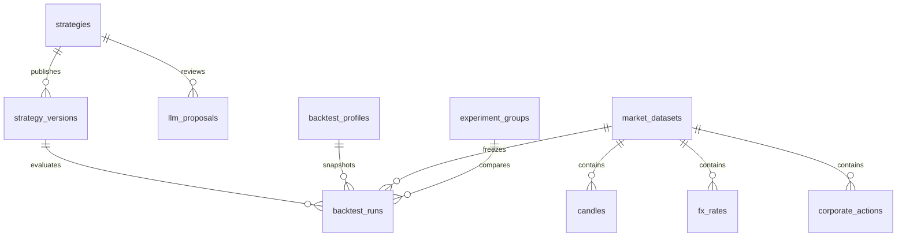

# Data model

IDs are UUID strings. Absolute timestamps use timezone-aware UTC in production. Candle session dates are exchange dates; XNYS calendar includes DST, holidays and early closes. XNAS instruments use the same regular-session US calendar in this MVP.

The single working draft lives on `strategies`, with an optimistic revision counter. Published versions have a per-strategy unique sequence, parent reference, schema version, normalized JSON and SHA-256. No version PATCH/DELETE API exists; database triggers reject input UPDATE/DELETE as a second boundary.

Dataset revisions normalize candles (unique dataset/symbol/session), FX (unique dataset/observation/availability) and actions into indexed tables. Provider, raw-adjustment policy, source timestamps, availability policy, quality flags, ingestion time, dividends completeness and coverage are retained. A revision hash includes sorted validated candles/FX/actions and methodology, excluding its human-readable name. Duplicate imports return the same revision. Export and worker loads verify the content hash.

Runs reference immutable strategy/dataset rows, and store a profile snapshot, profile/config/data hashes, engine/execution/indicator versions, coverage, status, ownership token, heartbeat, timestamps, error and result JSON. There is no randomness in the engine. Completed results contain deterministic order IDs, fills, trades, signals, ledgers, positions/receivables, equity, analytics and benchmark. Large results are deferred during job-list polling. Per-run JSON is deliberately simpler than a table for each ledger row at daily MVP scale.

Experiments retain common profile snapshots and dataset IDs; every member run has an independent ledger. Queue admission is bounded and serialized with a PostgreSQL advisory transaction lock; claiming uses `FOR UPDATE SKIP LOCKED` plus a conditional ownership update. Queue state and result publication are transactional.
