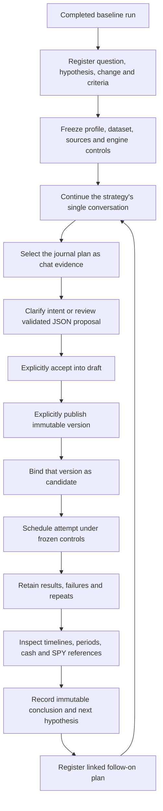

# Strategy research journal

The journal wraps the existing simulator, published versions and run history. It does
not change engine 2.0.0 or automatically optimize a strategy. Use the entire
2018–2025 period for sequential development as requested; repeatedly examining
these years makes them in-sample development data.

## Use the journal

1. Open **Research journal** and choose a completed baseline. Enter the question,
   hypothesis, intended rule change and evaluation criteria. Registration is
   immutable and records the current strategy conversation sequence.
2. Select **Prospective** when the candidate will be published after registration.
   Existing versions require **Retrospective**. This label describes registration
   chronology, not an unseen holdout period or proof of a hypothesis's origin.
3. Continue the strategy conversation. In its evidence picker, select the journal
   plan and preview its evidence. The assistant receives the frozen baseline rules,
   controls, recorded decisions, yearly period reports and available outcomes. Ask for the precise change.
   No new conversation is created, and selecting evidence sends no message.
4. Review the proposed JSON, accept it into the draft, then publish explicitly.
   Bind that published version in the journal. Its conversation snapshot remains
   available read-only.
5. Schedule attempts or attach existing matching runs. Costs, funding, dates,
   daily dataset, source revision bindings and engine controls must match the
   baseline. Changing these requires a new baseline/plan. Scheduling requires a
   synthetic-data acknowledgement when applicable.
6. Inspect all attempts, including failed/cancelled runs. Open the existing Compare
   screen for account timelines, year/quarter/month performance, cash and SPY
   references. Deltas mean candidate minus baseline; a larger number is not always
   better, especially for signed drawdown.
7. Once all recorded attempts finish, record an improved/worse/mixed/inconclusive
   assessment, reasons and next hypothesis. The journal freezes the attempt
   statuses, result hashes and scalar metric differences at that point. Subsequent
   interpretation can be appended as a note or a linked follow-on plan.

A run's full immutable result remains the authority. Journal summaries retain
scalar metrics, not daily-return arrays; the full-result hash and links preserve
access to the complete evidence. The initial acceptance plan, registered before
this display reduction, retains its original larger immutable snapshot.

## Controls and persistence

Migration **008_research_journal** adds immutable `research_studies` and
`research_events`. PostgreSQL and SQLite migrations install update/delete
protection. Events are append-only, with one candidate and one conclusion per plan.
Failed attempts are not overwritten by successful retries. Scheduling and journal
recording commit atomically through the existing scheduling service; validation
failure cannot leave an untracked queued run. Request identifiers support retries,
and the UI retains them after a failed request to avoid duplicate scheduling when
a response is lost.

The comparison fingerprint includes dataset/profile hashes, engine version,
execution/indicator models and both external-context and strategy-input manifests.
The journal creates a separate profile from the baseline's frozen profile snapshot
and checks it before scheduling. Editing that profile cannot silently change a
study's conditions. Published candidate rules and source revisions remain immutable.

Selected journal evidence is research commentary, not a trading source. Earlier
cutoffs reject plans that did not exist yet, exclude later journal events, and
withhold job outcomes completed after the cutoff. The existing chat input budget
still applies and fails explicitly rather than silently truncating history.

## API

All paths are under `/api/research/studies`:

| Method and path | Purpose |
| --- | --- |
| `GET /` | List plans, optionally filtered by strategy; bounded list limit |
| `POST /` | Register immutable prospective/retrospective plan from a completed baseline |
| `GET /{id}` | Plan, append-only events, actual attempt statuses and metric differences |
| `POST /{id}/candidate` | Bind one published version of the same strategy |
| `POST /{id}/schedule` | Atomically schedule and record an attempt under frozen conditions |
| `POST /{id}/runs` | Attach an existing matching candidate run |
| `POST /{id}/notes` | Append an identified research note |
| `POST /{id}/conclusion` | Freeze an assessment with every recorded terminal attempt |

The journal bounds each plan to 500 events, list responses to at most 500 plans,
and chat selection to five plans. Compare links select the first six completed
baseline/candidate runs; remaining attempts remain accessible individually.
Externally scheduled runs are retained globally but must be attached explicitly
to appear in a journal. There is no automatic significance test, parameter search,
evidence-quality certification or guarantee that the assistant's reasoning is sound.

See [actual acceptance results](research-journal-verification-2026-11-08.md).
