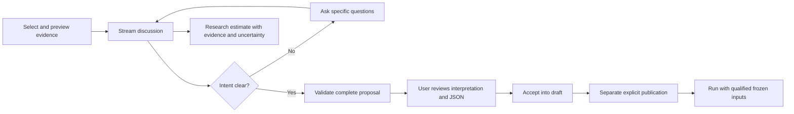

# Strategy conversations, evidence and estimates

Open a saved strategy's **Strategy conversation** panel. Describe the strategy or
change in ordinary language. Material ambiguity should produce specific questions
and choices, rather than guessed trade sizes, schedules or risk limits. Answer in
free text or use the suggested choices to compose your next message. Choices do
not submit automatically. The conversation remains attached to that strategy.

Each strategy has exactly one permanent conversation. **Read complete conversation**
opens its full archive. Every published version offers **Read conversation through
version N**, an immutable read-only transcript ending at that publication. Later
discussion continues in the same conversation without changing earlier snapshots.

For example, “make it safer and buy smaller positions more often” needs clarification
about the meaning of safety, budget, frequency, additions and exit conditions.
“Spend SGD 500 including fees on the first weekly close; preserve entry rules and
sell half when RSI14 exceeds 65” supplies concrete choices. Fixed-notional sizing
is an account-currency budget including the configured cost allowance before
rounding; gaps and affordability can change actual spending or reject an order.
Funding, starting capital and transaction costs remain independent profile fields.

## What the user sees

The text streams progressively from the configured provider. Activity entries show
evidence preparation, generation and final validation. They report application
operations, not private model reasoning. The text is explicitly provisional until
the complete reply passes schema and citation validation. **Stop reply** cancels
the request; partial text is retained as interrupted evidence and cannot update
the draft. Network failures, truncation and invalid replies also retain no proposal.

The thread scrolls within the panel and follows incoming replies unless the user
scrolls back to read earlier messages. Failed/stopped messages remain available
for audit and their input is restored for editing/retry.

Each turn's expandable evidence audit records the model/prompt version, source
names, synthetic/review status, source URLs where supplied, availability policy,
content hashes, cutoff, exact summaries shared and full context snapshot. Completed
turns also retain provider request ID/usage when returned. Failure records expose
safe categories, not provider bodies or credentials. There is no precise cost meter.

Choose **evidence to share** before sending: an accounting dataset, profile,
reviewed source revisions and/or completed research runs. **Preview evidence**
shows the server-built context without calling the LLM. Nothing is selected by
default. These selections retrieve existing local revisions/results; they do not
search the web, collect new news, fetch vendor data or approve a source.

The context supplies bounded raw-close summaries and public-event summaries, not
entire market archives, article bodies, intraday rows or security-state histories.
Raw closes across splits do not measure investment return. Run evidence includes
the immutable tested strategy configuration/hash, profile snapshot, metrics and
provenance, so its results can be distinguished from the current draft. Source
selection for a conversation is independent of binding eligible inputs to a run.

## Estimates and historical boundaries

The assistant can discuss hypotheses, educated guesses and conditional predictions
grounded in the selected evidence. Structured estimate cards identify the horizon,
method, uncertainty and supporting evidence IDs. Without a defensible numerical
basis, it should use qualitative estimates or request evidence. It must not claim
access to unseen news or fabricate a sourced forecast when no data is supplied.

Estimates are research commentary. They are never automatically imported as
observations, used as historical signals, treated as actual returns or inserted
into strategy JSON. They are not calibrated forecasts or proof that a tweak will
improve performance. No ML training, automatic optimization or live execution is
introduced. Repeated experiments on 2018–2025 remain in-sample research.

An optional evidence cutoff filters local bars/events by recorded availability and
rejects completed-run results extending beyond that timestamp, including later
marks on the same date. Later-cutoff turns are explicitly withheld. If an older
assistant reply cites deselected evidence, its facts are withheld but its user
intent remains. All eligible prior messages and proposed rule JSON are supplied;
there is no latest-eight-turn memory window. Failed/interrupted user requests
also remain part of the context, with their unvalidated replies withheld.
The active UI displays the latest 100 turns; the complete read-only archive is
paginated. The audit lists included and withheld IDs. If the complete input exceeds
the 140,000-character serialized budget, the request fails explicitly instead of
silently dropping old history. No automatic lossy compaction is implemented.
This bounds retrieved evidence; it does not certify a general model's learned
knowledge as an original-time information archive. Simulation causality continues
to be enforced separately by the existing engine and reviewed source clocks.

## Draft and publication workflow

Clarification/discussion/unsupported replies cannot contain strategy configuration.
A proposal must have no unanswered questions or unsupported requests. Its review
appears in **Proposal review**, using the existing checkbox and acceptance action.
Acceptance edits only the draft. **Publish new version** is a separate action.
Saved proposals can be reopened from their retained turn; stale/accepted proposals
remain protected by the existing revision/acceptance checks. Missing data can block
execution even when a proposed rule is supported by the schema.

The older single-request interface is retained under **Single-request compatibility
assistant** for complete prompts; it does not provide conversation memory or the
new clarification contract. Use the conversation panel for the workflow above.

## API and operation

- `GET /api/llm/strategies/{id}/turns`: retained recent conversation.
- `GET /api/llm/strategies/{id}/conversation`: permanent one-to-one identity.
- `GET /api/llm/strategies/{id}/history`: complete paginated read-only history.
- `GET /api/llm/strategies/{id}/versions/{version_id}/conversation`: frozen transcript.
- `GET /api/llm/strategies/{id}/versions/{version_id}/conversation/export`: full snapshot/hash.
- `POST /api/llm/strategies/{id}/context`: preview a `ChatSelection`.
- `POST /api/llm/strategies/{id}/turns`: SSE conversation, with `request_id`,
  `expected_revision`, `message` and `selection`.
- `GET /api/llm/proposals/{id}`: reopen a retained proposal.

SSE events are `context`, `status`, repeated `delta`, then `complete` or `error`.
Only a validated complete reply can create an unaccepted proposal. Nginx buffering
is disabled and the response specifies `X-Accel-Buffering: no`. The frontend
decodes chunked UTF-8/SSE, supports cancellation and rejects incomplete streams.
One stream per strategy is admitted; duplicate request IDs/stale draft revisions
are rejected. A five-minute orphan lease permits recovery after a crashed worker.
The provider call has a 180-second overall deadline and bounded response/context.

Apply through **007_conversation_versions** before updated API startup. Existing
`LLM_API_KEY`, `LLM_MODEL` and optional `LLM_BASE_URL` stay server-side. No new key
is needed. Tests used configured `gpt-6-luna` through Chat Completions with strict
structured output and streaming; see the
[official OpenAI structured-output guide](https://developers.openai.com/api/docs/guides/structured-outputs).
The latest verification project uses 18086/15444 and its own volume; pre-existing
deployments were not upgraded by this work.

See [measured chat tests](strategy-conversation-verification-2026-11-07.md),
[complete recall/version trace](conversation-history-verification-2026-11-07.md),
[historical data qualification](intraday-congress-verification-2026-11-07.md)
and the [visual workflow](data-workflow.html#conversation).
